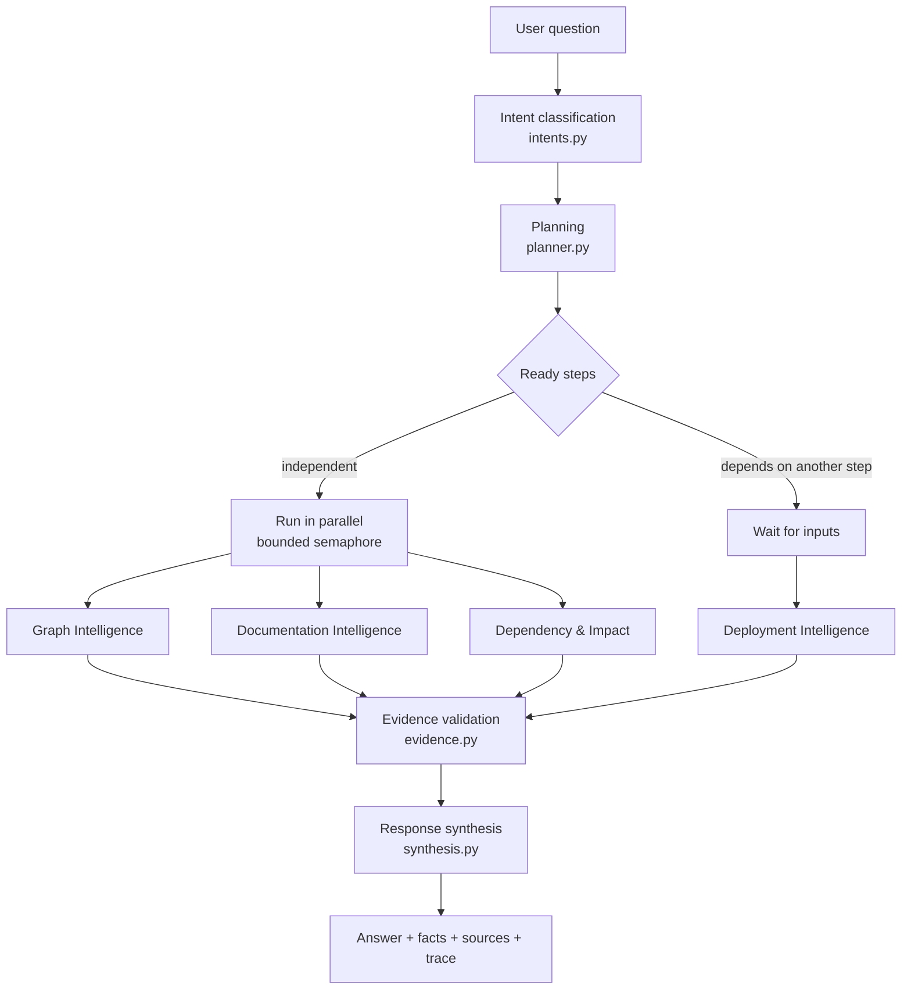
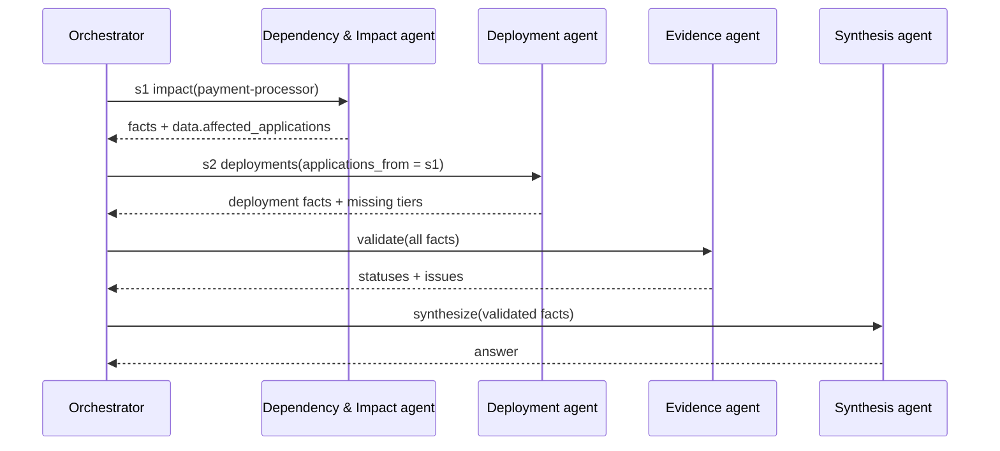

# Agentic Workflow

The platform answers enterprise questions with a **controlled, deterministic multi-agent workflow**.
A central orchestrator classifies the question, plans the work, runs specialist agents (in parallel
where possible), validates every fact against stored provenance, and composes an answer from
validated facts only.

There is no language model inside the platform. Classification and planning are rule-based; agents
call existing query-engine operations. The calling AI assistant does the language reasoning; the
platform guarantees grounded, traceable facts. This keeps answers reproducible, testable and free of
fabricated data.

Code: `src/ontology_platform/agents/`.

## Execution flow

| Stage | Module | What it does |
|---|---|---|
| Intent classification | `intents.py` | Links entity names in the question (existing `EntityLinker`, cached per tenant revision) and detects one or more intents with keyword rules applied to the question with entity names masked out |
| Planning | `planner.py` | Turns intents + entities into steps with explicit `depends_on`; always ends with validation and synthesis; bounded by `OP_AGENT_MAX_STEPS` |
| Execution | `orchestrator.py` | Runs ready steps concurrently (semaphore `OP_AGENT_MAX_PARALLEL`), each in a worker thread with its own DB session, a timeout (`OP_AGENT_STEP_TIMEOUT_SECONDS`) and bounded retries for transient errors (`OP_AGENT_MAX_RETRIES`) |
| Validation | `evidence.py` | Grades every fact *confirmed*, *inferred* or *unsupported* from provenance and entity status |
| Synthesis | `synthesis.py` | Builds the answer from confirmed and inferred facts only; lists missing information and limitations |
| Persistence | `store.py` | Stores each run (plan, events, facts, validation, answer) in `workflow_runs`, tenant-scoped |

### Intents

| Intent | Example | Agent / action |
|---|---|---|
| `impact` | "What happens if Payment Service goes down?" | Dependency & Impact / `impact` |
| `dependents` | "Which applications depend on Payment Service?" | Dependency & Impact / `impact` |
| `dependencies` | "What does payments-platform depend on?" | Dependency & Impact / `dependencies` |
| `deployments` | "Where is Application Y deployed across SIT, UAT and Production?" | Deployment Intelligence |
| `repositories`, `apis`, `clusters` | "Which repositories belong to Customer A's Product X?" | Graph Intelligence |
| `relationship` | "What is the relationship between Customer A, Product X and Application Y?" | Graph Intelligence / `relationship_paths` |
| `documentation` | "What documentation describes Payment Service authentication?" | Documentation Intelligence |
| `entity_lookup` | "Tell me about ledger" | Graph Intelligence / `entity_details` |

A question can have several intents. Only the agents needed for those intents run.

### Parallel and sequential execution

* *"Where is claims-portal deployed and what documentation describes it?"* →
  deployment and documentation steps have no dependency and run **concurrently** (a
  `parallel_batch` event records it).
* *"Which applications depend on Payment Service, and where are they deployed?"* →
  the deployment step needs the affected applications, so it declares `depends_on: [s1]` and runs
  **after** the impact step, reading its structured output (`applications_from`).

## Specialist agents

All agents receive a `QueryEngine` bound to the caller's **tenant and customer scope** and reuse
existing operations; none contains its own graph or search logic.

| Agent | Reuses | Produces |
|---|---|---|
| Graph Intelligence | `QuestionAnswerer.repositories/apis/clusters`, `QueryEngine.find_relationships`, `get_entity_details` | Ownership/composition paths, relationship chains, entity details |
| Documentation Intelligence | `QuestionAnswerer.documentation`, `QueryEngine.search_documentation` | Documents linked by `describes` edges and BM25-ranked passages with source URLs |
| Dependency & Impact | `QueryEngine.trace_dependencies` (upstream and downstream) | Dependents/dependencies with paths, affected applications and customers, circular-dependency detection |
| Deployment Intelligence | `QueryEngine.get_deployment_information` | Deployment per customer and tier with clusters, namespace and provenance; missing tiers reported |
| Evidence Validation | stored provenance and entity status | Fact status and validation issues |
| Response Synthesis | validated facts | Summary, sections, confirmed/inferred facts, missing information, limitations, sources |

## Evidence model

Every fact carries the graph path that supports it and, per edge, the provenance recorded at
ingestion time (source system, URL, extractor, confidence, evidence snippet). Nothing is generated.

| Status | Rule |
|---|---|
| **confirmed** | every edge has provenance from a structured source with confidence ≥ 0.8, and all entities are active |
| **inferred** | provenance exists, but some edge relies only on a text mention, a reference, or confidence < 0.8, or an entity is a placeholder (referenced but not defined by its own source) |
| **unsupported** | no provenance, an edge without provenance, or a stale/invisible entity — excluded from the answer and reported as an `UNSUPPORTED_FACT` issue |

Run-level validation status: `validated` (all facts confirmed, no failed step), `partially_validated`,
`insufficient_evidence` (no facts) or `failed` (no retrieval step completed).

Other issues raised: `STEP_FAILED`, `STEP_SKIPPED`, `MISSING_INFORMATION`, `CIRCULAR_DEPENDENCY`,
`CONFLICTING_EVIDENCE`.

## Reliability rules

* Plans are bounded and acyclic; there are no agent loops.
* Only transient errors (database operational errors, transient connector errors, timeouts) are
  retried, at most `OP_AGENT_MAX_RETRIES` times. Deterministic errors fail immediately.
* A step whose dependency failed is **skipped**, never run on missing input.
* Validation and synthesis always run, so failures appear in the answer instead of being hidden.
* A timed-out step is reported as failed; its worker thread cannot be interrupted and finishes in the
  background, and its result is discarded.
* Permission `graph:read` is checked before the workflow and again before every agent call.
* With in-memory SQLite (tests), steps run one at a time because that database shares a single
  connection; with PostgreSQL or file-based SQLite they run concurrently.

## Observability

Every run records a timeline of events (`workflow_started`, `intent_classified`, `plan_created`,
`parallel_batch`, `step_started`, `step_retry`, `step_completed`, `step_failed`, `step_skipped`,
`workflow_finished`) and per-step status, attempts, duration and tools invoked. No internal prompts or
hidden reasoning exist to expose: the trace is the plan and the operations performed.

Prometheus metrics: `op_workflow_runs_total{status}`, `op_workflow_seconds`,
`op_agent_steps_total{agent,status}`, `op_agent_step_seconds{agent}`, plus `op_db_query_seconds{operation}`.
Logs carry the run's correlation id (`wf-<run id>` unless the HTTP request supplied one).

## Interfaces

* Python: `await PlatformService.run_workflow(principal, question)`, `get_workflow`, `list_workflows`.
* REST and MCP endpoints: see [API_DOCUMENTATION.md](API_DOCUMENTATION.md) and [MCP_INTEGRATION.md](MCP_INTEGRATION.md).

## Known limitations

* Intent rules are keyword-based; unusual phrasings may fall back to entity lookup or documentation search.
* Document retrieval is lexical (BM25); there is no vector search.
* Impact analysis follows declared dependencies; it shows what *could* be affected, not observed failures.
* Conflicting property values from different sources are not detected (the store keeps the latest value plus version history).
