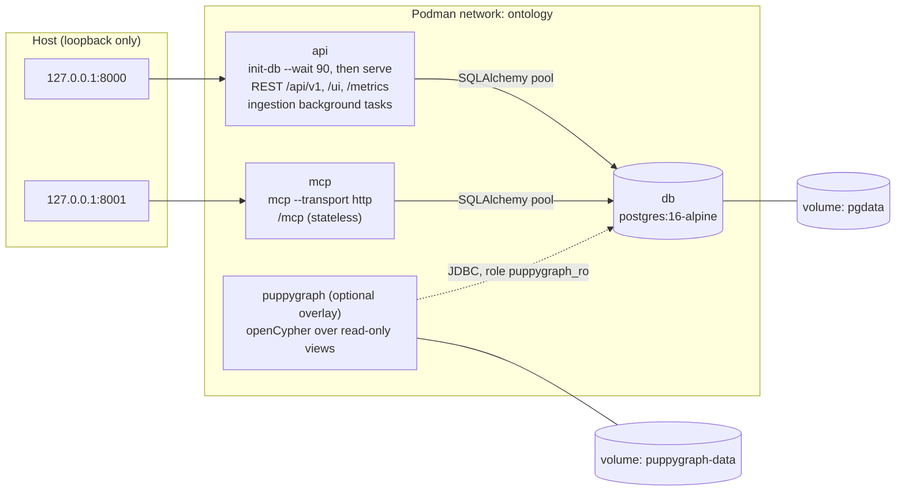

# Deployment

The platform ships as one OCI image (`Containerfile`) run as two services, the REST API and the MCP
server, over PostgreSQL 16, orchestrated with Podman Compose (`compose.yaml`).

* Container setup, daily commands and troubleshooting: [docs/PODMAN.md](docs/PODMAN.md).
* First-time setup from scratch: [docs/LOCAL_WALKTHROUGH.md](docs/LOCAL_WALKTHROUGH.md).

This document covers the architecture, configuration, migrations, monitoring, scaling and backups.

## 1. Architecture



| Service | Command | Published | Health check |
|---|---|---|---|
| `db` | PostgreSQL 16 | not published | `pg_isready` |
| `api` | `ontology-platform init-db --wait 90 && ontology-platform serve --host 0.0.0.0 --port 8000` | `127.0.0.1:${OP_API_PORT:-8000}` | `GET /ready` |
| `mcp` | `ontology-platform mcp --transport http --host 0.0.0.0 --port 8001` | `127.0.0.1:${OP_MCP_PORT:-8001}` | none |

* Only `api` runs migrations, which avoids concurrent migrations; `mcp` starts after `api`.
* Ingestion started over REST runs as a background task inside the `api` process. Scheduled syncs
  are external: run `ontology-platform sync` from cron or a Kubernetes CronJob (for Compose,
  `podman compose exec api ontology-platform sync --tenant <t> --all`).
* The image runs as UID 10001, uses only named volumes and contains the sample dataset.
* **PuppyGraph overlay** (`poc/puppygraph/compose.puppygraph.yaml`, evaluation only): adds a
  `puppygraph` service (ports 8081, 7687 and 8182 on loopback, volume `puppygraph-data`) and
  publishes `db` on `127.0.0.1:${PG_HOST_PORT:-5432}`. It is not part of the default stack. See
  [poc/puppygraph/FINDINGS.md](poc/puppygraph/FINDINGS.md) and
  [DESIGN_DECISIONS.md](DESIGN_DECISIONS.md#adr-002-puppygraph-evaluated-but-gated).

## 2. Configuration

The application reads `OP_*` environment variables (`src/ontology_platform/config.py`). When run
outside containers it also reads a `.env` file in the working directory.

**In containers, only the variables listed in the `x-app-env` block of `compose.yaml` reach the
application:** database URL, logging, environment label, all JWT settings (`OP_JWT_KEY`,
`OP_JWT_AUDIENCE`, `OP_JWT_ISSUER`, `OP_JWT_ALGORITHM`), the connection-pool settings and the agent
limits, each defaulting to the value below, plus `OP_MCP_ALLOWED_HOSTS` for `mcp`. Anything else,
such as connector secrets like `GITHUB_TOKEN`, must be added to `x-app-env`.

### Application settings

| Variable | Default | Allowed | Purpose |
|---|---|---|---|
| `OP_ENVIRONMENT` | `local` | any | Deployment label; informational |
| `OP_DATABASE_URL` | `sqlite:///./ontology.db` | SQLAlchemy URL | Compose sets `postgresql+psycopg://...@db:5432/...` |
| `OP_DB_POOL_SIZE` | `10` | 1–200 | Persistent connections per process (PostgreSQL only) |
| `OP_DB_MAX_OVERFLOW` | `10` | 0–200 | Extra connections allowed above the pool size |
| `OP_DB_POOL_TIMEOUT_SECONDS` | `30` | > 0 | Wait for a free connection before failing |
| `OP_LOG_LEVEL` | `INFO` | `DEBUG`, `INFO`, `WARNING`, `ERROR` | Level for `serve` and `mcp` (other CLI commands log at `WARNING`) |
| `OP_LOG_JSON` | `true` | bool | JSON log lines on stderr |
| `OP_JWT_ALGORITHM` | `HS256` | `HS256`, `RS256` | JWT algorithm |
| `OP_JWT_KEY` | unset | HS256: ≥ 32 characters; RS256: PEM public key | Enables JWT authentication |
| `OP_JWT_AUDIENCE` | unset | string | Required `aud` when set |
| `OP_JWT_ISSUER` | unset | string | Required `iss` when set |
| `OP_MCP_API_KEY` | unset | API key | Identity of the MCP **stdio** server; required for stdio |
| `OP_MCP_ALLOWED_HOSTS` | `""` | comma-separated `host:port` patterns | MCP HTTP `Host` allow-list ([MCP_INTEGRATION.md](MCP_INTEGRATION.md#1-transports)) |
| `OP_FUZZY_MATCH_THRESHOLD` | `0.92` | 0.5–1.0 | Entity resolution fuzzy-name threshold |
| `OP_HTTP_TIMEOUT_SECONDS` | `30.0` | | Connector HTTP timeout |
| `OP_HTTP_MAX_RETRIES` | `4` | 0–10 | Connector retries on 429, 5xx and network errors |
| `OP_HTTP_BACKOFF_BASE_SECONDS` | `0.5` | | Exponential backoff base (`base × 2^(attempt-1)`) |
| `OP_AGENT_STEP_TIMEOUT_SECONDS` | `20.0` | > 0, ≤ 300 | Timeout per agent step |
| `OP_AGENT_MAX_RETRIES` | `1` | 0–3 | Retries of an agent step after a transient error |
| `OP_AGENT_MAX_PARALLEL` | `4` | 1–32 | Concurrent agent steps per workflow run |
| `OP_AGENT_MAX_STEPS` | `12` | 1–50 | Maximum plan length |
| `OP_WORKFLOW_RUNS_RETAINED` | `1000` | ≥ 10 | Stored workflow runs kept per tenant |
| `OP_MAX_TRAVERSAL_DEPTH` | `6` | 1–12 | Upper bound on any traversal depth |
| `OP_MAX_RESULTS` | `200` | 1–5000 | Result cap for search and traversals |

Invalid values stop the process at startup (settings validation).

### Compose-level variables (`.env`)

| Variable | Default | Purpose |
|---|---|---|
| `POSTGRES_USER`, `POSTGRES_DB` | `ontology` | Database user and name |
| `POSTGRES_PASSWORD` | none (required) | Compose refuses to start without it |
| `OP_API_PORT`, `OP_MCP_PORT` | `8000`, `8001` | Host ports (bound to `127.0.0.1`) |
| `OP_IMAGE_TAG` | `0.1.0` | Image tag `localhost/ontology-platform:<tag>` |
| `PUPPYGRAPH_PASSWORD`, `PUPPYGRAPH_PG_PASSWORD` | none | PuppyGraph overlay only |

`.env.example` is the template. It does not list the pool and agent settings; their defaults apply.

## 3. Database migrations

Migrations are Alembic revisions in `src/ontology_platform/migrations/versions/`. Apply them with:

```powershell
ontology-platform init-db --wait 90
```

`--wait` retries the connection for up to that many seconds (containers can start before PostgreSQL
accepts connections). The command upgrades to the latest revision and is safe to repeat.
`seed-demo` also applies migrations. In Compose, `api` runs `init-db` on every start.

| Revision | Change |
|---|---|
| `0001` initial schema | Tenants, entities, aliases, relationships, provenance, version history (`graph_changes`), documents and chunks, source records, connectors and state, ingestion runs, API keys, audit log, graph revisions |
| `0002` workflow runs | `workflow_runs` table (tenant, principal, query, status, validation status, intents, full run document, timing) with index `(tenant_id, started_at)` |
| `0003` one running ingestion | Marks all but the most recently started `running` ingestion run per connector as `failed` (`superseded duplicate running run`), then creates the partial unique index `uq_run_one_running` on `(tenant_id, connector_id) WHERE status = 'running'` |

Every revision has a `downgrade`; the CLI only upgrades. `alembic.ini` exists for developers creating
new revisions (`alembic revision --autogenerate`), using `OP_DATABASE_URL`.

## 4. Health, readiness and metrics

| Endpoint | Meaning |
|---|---|
| `GET /health` | Process is up (`{"status": "ok"}`); no database access |
| `GET /ready` | Database answers `SELECT 1` (`{"status": "ready"}`); fails with `500` otherwise. Used by the `api` health check |
| `GET /metrics` | Prometheus exposition, unauthenticated |

Metrics (`src/ontology_platform/observability.py`):

| Metric | Type | Labels |
|---|---|---|
| `op_http_requests_total` | counter | `method`, `route`, `status` |
| `op_query_seconds` | histogram | `operation` (service operation, e.g. `query_knowledge_graph`) |
| `op_db_query_seconds` | histogram | `operation` (`SELECT`, `INSERT`, `UPDATE`, `DELETE`, `WITH`, `OTHER`) |
| `op_mcp_tool_calls_total` | counter | `tool`, `outcome` |
| `op_ingestion_runs_total` | counter | `connector_type`, `status` |
| `op_ingested_records_total` | counter | `connector_type`, `outcome` |
| `op_graph_writes_total` | counter | `subject`, `change` |
| `op_workflow_runs_total` | counter | `status` |
| `op_workflow_seconds` | histogram | none |
| `op_agent_steps_total` | counter | `agent`, `status` |
| `op_agent_step_seconds` | histogram | `agent` |

Each process has its own metrics registry, and only the API process serves `/metrics`. The `mcp`
container has no metrics endpoint, so `op_mcp_tool_calls_total` and the query and workflow metrics of
calls made over MCP are recorded but not exposed.

**Logs** are JSON lines on stderr (`podman compose logs -f api`), with a `correlation_id` taken from
the request's `X-Request-ID` (or generated) and, for workflow runs, `wf-<run id>` when no request id
exists.

## 5. Scaling and capacity

**Connection pools.** Each process (`api`, `mcp`, any CLI invocation) has its own SQLAlchemy pool of
up to `OP_DB_POOL_SIZE + OP_DB_MAX_OVERFLOW` connections, with `pool_pre_ping` enabled. Keep the sum
over all processes below PostgreSQL's `max_connections`. A request that cannot get a connection
within `OP_DB_POOL_TIMEOUT_SECONDS` fails.

**Request concurrency.** Synchronous REST handlers run in FastAPI's thread pool and synchronous MCP
tools in the SDK's worker threads; each operation uses its own session.

**Agent parallelism.** One workflow run executes up to `OP_AGENT_MAX_PARALLEL` steps at a time, each
in a worker thread holding one connection while it runs. Concurrent runs multiply this, so size the
pool for (concurrent requests + concurrent runs × `OP_AGENT_MAX_PARALLEL`). A step that exceeds
`OP_AGENT_STEP_TIMEOUT_SECONDS` is reported as failed, but its thread (and connection) is released
only when the underlying query finishes. With in-memory SQLite, steps run one at a time.

**Ingestion.**
* At most one running ingestion per connector, enforced by the partial unique index from `0003`,
  which holds across processes and replicas. A second start returns `409`.
* A run still `running` after 6 hours is treated as abandoned and marked `failed` at the next start
  of that connector.
* `ontology-platform sync --tenant <t> --all --parallel N` syncs up to N connectors concurrently
  (forced to 1 on in-memory SQLite). A failing connector does not stop the others, and the report
  includes per-connector results and totals. Without `--parallel` connectors run one after another.
  Either way the command exits with status 1 if any connector failed.

**Caches.** BM25 indexes and the entity-linking alias index are held in an in-process LRU cache
(32 entries) keyed by tenant, graph revision and customer scope. Each process builds its own; a new
graph revision makes stale entries unused.

**Replicas.** The API and MCP processes keep no session state (MCP HTTP is stateless), so more
replicas can share one database; let only one of them run migrations. Background ingestion runs in
whichever API process accepted the sync request.

**Data growth.** Workflow runs are pruned to `OP_WORKFLOW_RUNS_RETAINED` per tenant after each run.
`audit_log`, `graph_changes` and `ingestion_runs` have no built-in retention.

**SQLite.** File-based SQLite (WAL mode) is suitable for a single user or development; use
PostgreSQL for shared deployments.

## 6. Backups and volumes

All durable state is in PostgreSQL: the graph, provenance, version history, connectors (without
secrets), ingestion runs, API key hashes, workflow runs and the audit log. Caches are rebuilt on
demand, and the sample data is in the image.

| Volume | Content | Notes |
|---|---|---|
| `pgdata` | PostgreSQL data directory | `podman compose down` keeps it; `podman compose down -v` **deletes** it |
| `puppygraph-data` | Uploaded PuppyGraph schema (overlay only) | Regenerated by `poc/puppygraph/setup_poc.py` |

The platform has no built-in backup job. With standard PostgreSQL tools, for example:

```powershell
podman compose exec db pg_dump -U ontology -d ontology -Fc -f /tmp/ontology.dump
```

```powershell
podman cp <db container>:/tmp/ontology.dump .\ontology.dump
```

Restore into an empty database with `pg_restore`. Get the container name from `podman ps`. Secrets are
not in the database: back up `.env` and any mounted secret files separately. For SQLite, copy
`ontology.db` (and its `-wal`/`-shm` files) while no process is using it.

## 7. Before exposing the stack beyond localhost

* Terminate TLS in a reverse proxy; the platform serves plain HTTP.
* Set `OP_MCP_ALLOWED_HOSTS` to the public host names of the MCP endpoint.
* Restrict access to `/metrics`, `/docs` and `/openapi.json` at the proxy if needed.
* Use a strong `POSTGRES_PASSWORD`, and an `OP_JWT_KEY` of at least 32 characters (HS256) or an RS256
  public key.
* Review the limitations in [SECURITY.md](SECURITY.md#10-known-limitations), in particular the lack
  of rate limiting.
