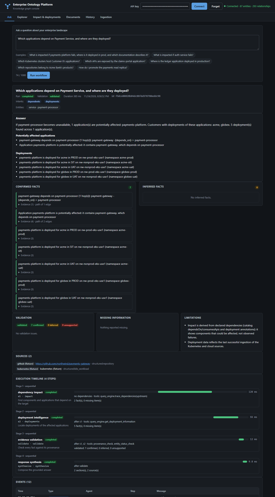
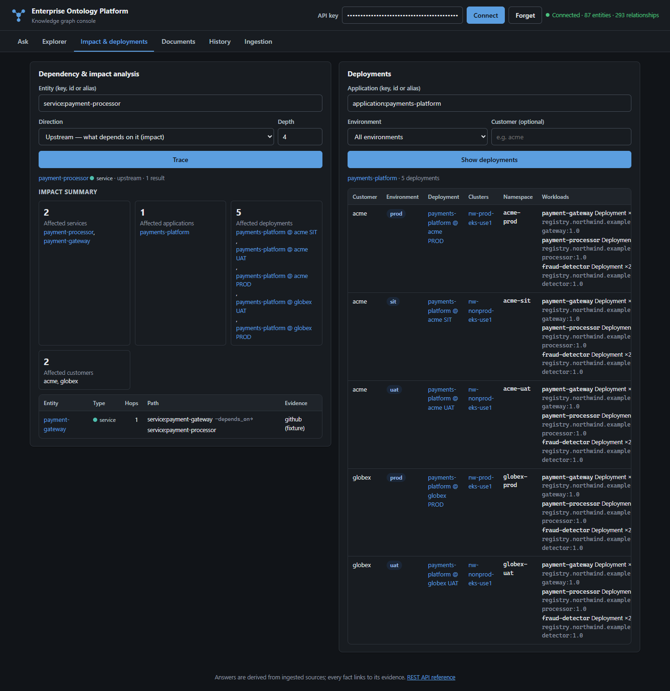

# Enterprise Ontology Platform

A unified knowledge graph of an enterprise's software landscape, exposed to AI assistants through
the **Model Context Protocol (MCP)**.

Enterprise knowledge is spread across many systems:
* source code in GitHub, GitLab and Bitbucket
* documentation in Confluence
* workloads in Kubernetes
* infrastructure in AWS, Azure and GCP

The platform connects to these systems and extracts the entities that matter: customers,
products, applications, services, APIs, repositories, databases, clusters, deployments,
environments and documentation. It links them into one graph, so questions like these can be
answered precisely, with the source of every fact:

* *Which repositories belong to Customer A's Product X?*
* *Where is Application Y deployed in SIT, UAT and Production?*
* *Which Kubernetes clusters host Customer B's applications?*
* *What is affected if Service X goes down?*

## Features

| Area | What it does |
|---|---|
| **Connectors** | GitHub, GitLab, Bitbucket, Confluence, Kubernetes, AWS, Azure, GCP, catalog files (CMDB/CRM exports), push API |
| **Ingestion** | Incremental and idempotent; extracts entities from Backstage `catalog-info.yaml`, OpenAPI specs, READMEs, Kubernetes labels, cloud tags and document text |
| **Knowledge graph** | 13 entity types, 14 relationship types, entity resolution and de-duplication, provenance and version history for every fact |
| **Query engine** | Graph traversal, dependency and impact analysis, deployment lookup, document search, and natural-language questions answered with evidence paths |
| **Agentic workflow** | Multi-part questions are classified, planned and run by specialist agents (in parallel where possible); every fact is graded confirmed, inferred or unsupported against its provenance; each run is stored with its plan and trace |
| **Interfaces** | MCP server (stdio and HTTP), REST API with OpenAPI docs, web console at `/ui`, CLI |
| **Security** | API keys and JWT, roles, strict tenant isolation, per-customer access restriction with evidence redaction, audit log with credential redaction |
| **Operations** | PostgreSQL with migrations, Podman containers, structured logs, Prometheus metrics, bounded parallel ingestion |

## How it works

```
 Sources ──▶ Connectors ──▶ Extraction ──▶ Entity resolution ──▶ Knowledge graph (PostgreSQL)
 (code, docs, cloud, k8s)                                                  │
                                                                           ▼
                              Agent workflow ◀───────────────────── Query engine
                     (plan · specialist agents · validate)                 │
                                     └──────────────┬──────────────────────┘
                                                    ▼
                  AI assistants ◀── MCP server ◀── access control, audit ──▶ REST API ──▶ /ui console
```

Every relationship keeps a record of where it came from (source system, URL, extractor,
confidence), so answers can always be traced back to their source.

A single, well-scoped question is answered by one graph query. A multi-part question ("what breaks
if X fails, and where is it deployed?") goes through the **agentic workflow**: a deterministic
orchestrator detects the intents, plans the steps, runs graph, documentation, dependency and
deployment agents over the query engine, validates every fact against stored provenance and composes
an answer from validated facts only. No language model runs inside the platform; the calling AI
assistant does the language reasoning. See [AGENTIC_WORKFLOW.md](AGENTIC_WORKFLOW.md).

The **web console** at `/ui` is a static page served by the REST API. Paste an API key to ask
questions, see the workflow plan and evidence, explore entities and paths, run impact analysis,
search documents, browse past workflow runs and view connectors and ingestion runs.

See [ARCHITECTURE.md](ARCHITECTURE.md) for the full design.

## Screenshots

All screenshots show the web console running against the bundled sample enterprise (PostgreSQL,
Podman). Every value shown comes from the knowledge graph; nothing is hardcoded.

### Agent workflow: impact analysis followed by deployment lookup



The question *"Which applications depend on Payment Service, and where are they deployed?"* has two
intents. The orchestrator plans two dependent steps: the **dependency & impact agent** finds that
`payments-platform` contains `payment-gateway`, which depends on `payment-processor` (alias "Payment
Service"); the **deployment agent** then reads that result and lists the application's five
deployments across the Acme and Globex SIT, UAT and PROD environments.

* **Answer:** a summary plus sections built only from facts.
* **Confirmed / inferred facts:** each fact can be expanded to show its graph path and the provenance
  (source system, URL, extractor, confidence) recorded at ingestion. Here all 7 facts are confirmed.
* **Validation, missing information, limitations:** the evidence agent's verdict (`validated`), what
  could not be found, and caveats such as "impact shows what could be affected, not observed failures".
* **Sources:** the source records behind the answer.
* **Execution timeline:** every step with its agent, status, duration, tools called and dependencies.
  These steps run in sequence because each needs the previous one's output.

### Agent workflow: independent steps run in parallel


*"Where is claims-portal deployed and what documentation describes it?"* plans a deployment step and
a documentation step that don't depend on each other, so they run **concurrently**; the timeline
shows them in the same stage. Facts that rest only on a text mention in a document are labelled
**inferred**, not confirmed.

### Knowledge graph explorer


Search by name or alias, then explore the neighbourhood of an entity as a graph (colour = entity
type; click a node to expand it). The details panel lists every relationship with its confidence and
the provenance of the entity, linking back to the source repositories and documents. The "Find
connection paths" form highlights the shortest paths between any two entities.

### Impact analysis and deployments



Direct access to the dependency trace (upstream = what is affected if a component fails;
downstream = what it depends on) and to deployments per customer and environment, with clusters,
namespaces and the cloud resources each deployment uses.

### Workflow history


Every workflow run is stored with its plan, events, facts, validation and answer, scoped to the
tenant (customer-restricted users see only their own runs). Opening a run shows it again in the
Ask view, which makes answers auditable after the fact.

## Quick start

The fastest way to try it uses Python and a local SQLite database. It needs Python 3.11.

```powershell
python -m venv .venv
```

```powershell
.venv\Scripts\pip install -e ".[dev]"
```

```powershell
.venv\Scripts\ontology-platform seed-demo
```

`seed-demo` creates the database and loads a sample enterprise (a fictional company,
"Northwind", with three customers, two products and six applications). It also prints API keys
for trying the platform.

Ask a question:

```powershell
.venv\Scripts\ontology-platform ask --tenant northwind "Which Kubernetes clusters host Customer B's applications?"
```

Start the REST API, then open http://127.0.0.1:8000/docs for the API, or
http://127.0.0.1:8000/ui for the web console (paste one of the printed API keys):

```powershell
.venv\Scripts\ontology-platform serve
```

For the full setup — PostgreSQL in containers with Podman, and connecting an AI assistant over
MCP — follow **[docs/LOCAL_WALKTHROUGH.md](docs/LOCAL_WALKTHROUGH.md)**.

## Connecting an AI assistant

The MCP server exposes ten tools:

| Tool | Purpose |
|---|---|
| `run_enterprise_intelligence_workflow` | Answer a multi-part question with the agentic workflow: validated facts, sources and a trace |
| `query_knowledge_graph` | Answer a single natural-language question with evidence |
| `search_entities` | Find entities by name, alias or keyword |
| `get_entity_details` | Properties, relationships, provenance and history of an entity |
| `get_related_entities` | Neighbours of an entity, up to N hops |
| `find_entity_relationships` | How two entities are connected |
| `search_documentation` | Search documentation passages |
| `trace_application_dependencies` | Dependencies, or impact analysis when run upstream |
| `get_deployment_information` | Deployments per customer and environment |
| `get_ontology_schema` | The entity and relationship types |

Any MCP-compatible assistant can connect:
* **HTTP:** `http://127.0.0.1:8001/mcp` with the header `Authorization: Bearer <api key>`. A
  template is in [.mcp.json.example](.mcp.json.example).
* **stdio:** see [docs/LOCAL_WALKTHROUGH.md](docs/LOCAL_WALKTHROUGH.md).

Transports, authentication and client configuration are described in
[MCP_INTEGRATION.md](MCP_INTEGRATION.md).

## Documentation

| Document | Contents |
|---|---|
| [docs/LOCAL_WALKTHROUGH.md](docs/LOCAL_WALKTHROUGH.md) | Step-by-step local setup, from zero to an AI assistant answering questions |
| [ARCHITECTURE.md](ARCHITECTURE.md) | Components, data flow, technology choices, database design |
| [AGENTIC_WORKFLOW.md](AGENTIC_WORKFLOW.md) | The multi-agent workflow: intents, planning, agents, evidence model, reliability rules |
| [API_DOCUMENTATION.md](API_DOCUMENTATION.md) | Every REST endpoint: permissions, parameters, responses, errors, examples |
| [MCP_INTEGRATION.md](MCP_INTEGRATION.md) | MCP transports, the ten tools, authentication, client configuration, concurrency |
| [SECURITY.md](SECURITY.md) | Authentication, roles, tenant and customer isolation, audit, secrets, known limitations |
| [DEPLOYMENT.md](DEPLOYMENT.md) | Deployment architecture, configuration reference, migrations, monitoring, scaling, backups |
| [TESTING.md](TESTING.md) | Running the tests, test data, what each test file covers, end-to-end scenarios |
| [DESIGN_DECISIONS.md](DESIGN_DECISIONS.md) | Architecture decision records |
| [ONTOLOGY_SCHEMA.md](ONTOLOGY_SCHEMA.md) | Entity and relationship types, identity rules, extraction conventions |
| [IMPLEMENTATION_PLAN.md](IMPLEMENTATION_PLAN.md) | Feature status, test coverage and roadmap |
| [docs/PODMAN.md](docs/PODMAN.md) | Container operations and troubleshooting |
| [poc/puppygraph/FINDINGS.md](poc/puppygraph/FINDINGS.md) | Evaluation of PuppyGraph as an alternative graph query engine |

## Project layout

```
src/ontology_platform/
  ontology/      entity and relationship types, identity rules
  connectors/    source system integrations
  extraction/    entity and relationship extraction
  resolution/    entity resolution and de-duplication
  ingestion/     ingestion pipeline
  storage/       database model and graph repository
  search/        text search index
  query/         graph query engine and question answering
  agents/        agentic workflow: intents, planner, specialist agents, evidence, synthesis
  auth/          authentication, authorization, audit
  api/           REST API and the static web console (api/static/)
  mcp_server/    MCP server
  migrations/    database migrations
sample_data/     sample enterprise dataset
tests/           automated tests
poc/puppygraph/  PuppyGraph evaluation
docs/            guides
```

## Development

Run the test suite (details, including the optional PostgreSQL tests, in [TESTING.md](TESTING.md)):

```powershell
.venv\Scripts\python -m pytest -q
```

Connectors for real systems take their credentials as references (`env:NAME` or `file:/path`); no
secret is ever stored in the database. To add a new source, implement a `Connector` subclass in
`src/ontology_platform/connectors/`. See ARCHITECTURE.md §11.
