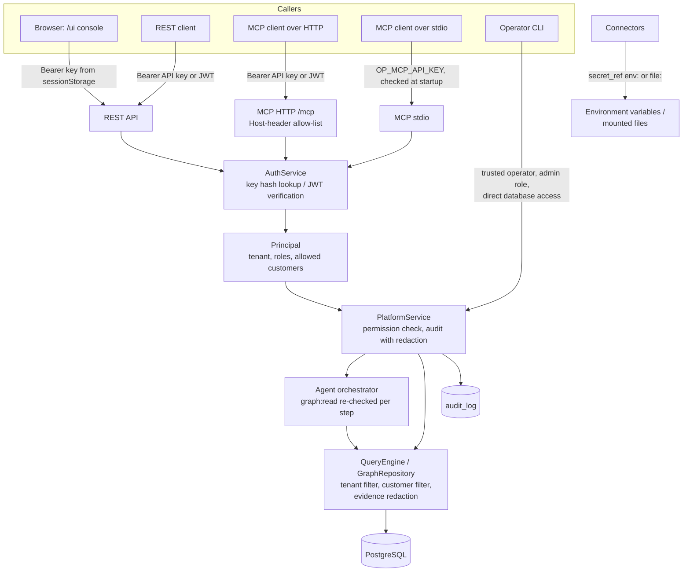

# Security

This document describes the security controls the code implements and their known limitations.
Code: `src/ontology_platform/auth/`, `service.py`, `storage/repository.py`, `api/ui.py`,
`mcp_server/server.py`, `config.py`.

## 1. Architecture

Every REST endpoint and MCP tool goes through `PlatformService`, which checks the permission, runs
the operation inside the principal's scope and writes an audit record.

## 2. Authentication

### API keys
* Format: `op_<key id>_<secret>`. The key id is 12 hex characters; the secret is 32 random bytes,
  URL-safe encoded (`secrets.token_urlsafe(32)`).
* Only the SHA-256 hash of the secret is stored (`api_keys.key_hash`). Comparison uses
  `hmac.compare_digest`.
* The plaintext is shown once, by `ontology-platform create-api-key`, `seed-demo` or
  `POST /api/v1/admin/api-keys`, and cannot be retrieved later.
* Keys can be revoked (`DELETE /api/v1/admin/api-keys/{id}`); a revoked key fails with `401`.
  `last_used_at` is updated on each successful use.

### JWT
JWT verification is disabled unless `OP_JWT_KEY` is set.

| Rule | Behaviour |
|---|---|
| Algorithm | Only `OP_JWT_ALGORITHM` is accepted: `HS256` (default, shared secret) or `RS256` (`OP_JWT_KEY` is the PEM public key) |
| HS256 key length | `OP_JWT_KEY` must be at least 32 characters for HS256; shorter keys make the settings fail to load, so the process does not start |
| Required claims | `exp` and `sub` |
| Audience / issuer | Verified when `OP_JWT_AUDIENCE` / `OP_JWT_ISSUER` are set |
| Tenant | `tenant` (or `tid`) claim, a string naming an existing tenant |
| Roles | `roles`: a list of `viewer`, `ingestor`, `admin`; unknown roles are rejected |
| Customer restriction | Optional `customers`: a list of strings. A present but malformed claim is rejected (fails closed) rather than treated as "all customers" |

The principal's subject is `jwt:`.

### Credential transport
* `Authorization: Bearer <api key or JWT>`. REST also accepts `X-API-Key` when `Authorization` is
  absent. Other schemes (for example `Basic`) are rejected.
* Failures return `401` with `WWW-Authenticate: Bearer`. The submitted credential is never echoed in
  the response or in MCP error text.

### CLI
The CLI connects to the database directly and acts as a trusted operator with the `admin` role for
the tenant named on the command line (subject `cli:<OS user>`). Access to the CLI is therefore
equivalent to database access.

## 3. Authorization

| Permission | viewer | ingestor | admin |
|---|:-:|:-:|:-:|
| `graph:read`: queries, search, agent workflow, workflow runs | ✓ | ✓ | ✓ |
| `connectors:read`: list connectors, connector types, ingestion runs | | ✓ | ✓ |
| `ingest:run`: start a sync, push records | | ✓ | ✓ |
| `connectors:write`: register connectors | | | ✓ |
| `keys:manage`: create, list and revoke API keys | | | ✓ |
| `audit:read`: read the audit log | | | ✓ |

A principal's permissions are the union over its roles. The endpoint-to-permission mapping is in
[API_DOCUMENTATION.md](API_DOCUMENTATION.md#3-endpoint-summary). The agent workflow checks
`graph:read` before it starts and again before every agent step.

## 4. Tenant isolation

* The tenant comes only from the credential; no request parameter selects it.
* Every database read and write filters on, or checks, `tenant_id`: entities, relationships,
  provenance, documents, connectors, ingestion runs, workflow runs, API keys and the audit log.
* Objects of another tenant are indistinguishable from missing ones (`404`), whether addressed by id,
  canonical key or name.
* Relationship writes require both endpoints to exist in the same tenant.
* Search and entity-linking caches are keyed by tenant (and by graph revision and customer scope).

Cross-tenant access over REST, MCP (stdio-style and HTTP) and the workflow is covered by
`tests/test_security.py`, `tests/test_auth_isolation.py` and `tests/test_api_workflow.py`.

## 5. Customer-scope access control

A principal may carry `allowed_customers` (API key column or JWT `customers` claim). `None` means
every customer of the tenant.

**Visibility.** Entities have a `customer_scope`: customers, environments and deployments always
have one, and cloud resources do when tagged with a customer (see
[ONTOLOGY_SCHEMA.md](ONTOLOGY_SCHEMA.md)). For a restricted principal:
* entities scoped to other customers are filtered out of every read;
* relationship queries require both endpoints to be visible, so traversals, path finding and impact
  analysis never pass through another customer's entities;
* graph statistics and search indexes are computed for the principal's scope.

**Evidence redaction.** A shared entity or relationship (for example "ledger-service runs on
nw-prod-eks-use1") can be observed in a source record that also produced another customer's
entities, such as that customer's Kubernetes workload. Its evidence text and URL would reveal the
other customer's namespace or resources. For restricted principals,
`GraphRepository.provenance_for` returns such rows as `RedactedProvenance`:

| Field | Value returned |
|---|---|
| `source_record_key` | `restricted` |
| `source_url` | `null` |
| `evidence` | `[restricted: observed in a source record of another customer]` |
| `source_system`, `extractor`, `confidence`, timestamps | kept |

`RedactedProvenance` is a detached, frozen object, so the stored provenance row is never modified.

**No privilege widening through keys.** When a customer-restricted principal with `keys:manage`
creates a key, the requested `allowed_customers` must be a subset of its own; omitting the list
(all customers) or naming another customer returns `403`. The check covers customers only; the
requested roles are not limited.

## 6. Audit log

`audit_log` rows record the tenant, principal subject, channel (`rest`, `mcp`, `cli`), action,
parameters, outcome (`ok`, `denied` for 401/403 errors raised inside an operation, `error`
otherwise), detail and timestamp. They are read through `GET /api/v1/admin/audit` (`audit:read`).

Audited operations: every graph query and MCP tool call, `run_workflow` (with the run id; the
detail holds the run status), `get_workflow`, `list_workflows`, `list_connectors`,
`register_connector`, `start_sync` (also used by push), `create_api_key` and `revoke_api_key`.

**Redaction** (`auth.service.redact`), applied to parameters and detail before storage:
* values under keys matching `secret`, `password`, `passwd`, `token`, `api_key`/`api-key`/`apikey`,
  `authorization`, `credential` or `private_key` (case-insensitive substring) become
  `***redacted***`; `None`, booleans and numbers are kept;
* a `secret_ref` is kept only when it is a reference (`env:NAME` or `file:...`);
* inside any string, platform API keys (`op_<hex>_<secret>`) and JWT-shaped tokens (`eyJ...`) are
  replaced;
* parameters larger than 4000 characters of JSON are stored as `{"truncated": true}`; detail is cut
  to 2000 characters.

A failure to write an audit record is logged and does not fail the request.

## 7. Secrets handling

* **Connector credentials** are never stored. A connector holds a `secret_ref` of the form
  `env:NAME` or `file:/path`; anything else is rejected at registration. The reference is resolved
  only when the connector runs; a missing variable or file fails that run with `connector_error`.
* **Platform secrets** (`OP_JWT_KEY`, `OP_MCP_API_KEY`) are `SecretStr` settings and are not printed
  in settings representations. Blank values count as unset.
* **Files.** `.env` and `.mcp.json` are git-ignored. `.containerignore` keeps `.env`, `.mcp.json`,
  `tests` and local databases out of the image. Compose refuses to start without `POSTGRES_PASSWORD`.
* **Responses and logs.** Error bodies, MCP error text and audit records do not contain submitted
  credentials (`tests/test_security.py::test_secrets_never_reach_error_bodies_or_audit`). Request
  logs record method, path, status, duration and request id, not headers.

## 8. Web console

The console under `/ui` is static (no server-side rendering, no secrets in the served files):
* the API key is kept in `sessionStorage` (cleared when the tab is closed or "Forget" is pressed)
  and sent only in the `Authorization` header, never in URLs;
* API data is rendered as text (`textContent`), never parsed as HTML;
* responses carry `Content-Security-Policy` (`default-src 'self'`, no third-party scripts, styles,
  fonts or connections, `frame-ancestors 'none'`), `X-Frame-Options: DENY`,
  `X-Content-Type-Options: nosniff`, `Referrer-Policy: no-referrer` and `Cache-Control: no-cache`.

These properties are checked by `tests/test_ui.py`.

## 9. Network and container controls

* **MCP HTTP DNS-rebinding protection:** `OP_MCP_ALLOWED_HOSTS` restricts accepted `Host` headers
  (details in [MCP_INTEGRATION.md](MCP_INTEGRATION.md#1-transports)).
* Compose publishes the API and MCP ports on `127.0.0.1` only and does not publish PostgreSQL.
* The application image runs as UID 10001 (non-root); only named volumes are used.

## 10. Known limitations

| Area | Limitation |
|---|---|
| Rate limiting | None on REST or MCP; there is no brute-force throttling of failed authentications. |
| Transport encryption | The platform serves plain HTTP. TLS must be terminated by a proxy before exposing ports beyond the host. |
| Unauthenticated endpoints | `/metrics`, `/docs`, `/redoc` and `/openapi.json` need no credential. Metrics contain route names, counts and latencies, not graph data. |
| Administrative surfaces | Customer-restricted principals see only their own workflow runs, can list and revoke only API keys whose customer access is within their own, and cannot read the tenant-wide audit log. Connector configuration and ingestion runs are not customer-scoped: a restricted principal with `connectors:read` sees all of the tenant's connectors and runs. |
| MCP stdio | The principal is resolved once at startup; revoking `OP_MCP_API_KEY` takes effect only when the process restarts. |
| Credential lifetime | API keys do not expire. JWTs cannot be revoked before `exp`. |
| Audit coverage | Authentication failures happen before a principal exists and are not written to `audit_log` (they appear in request logs as `401`). Listing connector types, ingestion runs, API keys and reading the audit log are permission-checked but not audited. |
| Key hashing | API key secrets are hashed with plain SHA-256, without salt or key stretching. The secrets themselves are 32 random bytes. |
